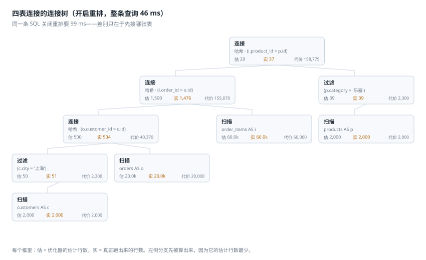
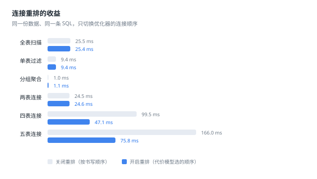

# Banyan

一个用纯 Python 标准库写的 SQL 查询引擎，重点不在"能跑 SQL"，而在**引擎怎么决定先算哪一步、以及它估错了多少**。

解析、逻辑计划、基于统计的代价模型、连接重排、火山模型执行器、估算偏差诊断，每一层都是独立模块，可以单独读、单独测。零第三方依赖，`import` 的全是 `re` / `csv` / `math` / `functools` 这些标准库。


---

## 为什么做这个东西

SQLite 已经足够好，不需要第 101 个数据库。但"数据库为什么这么执行"通常是个黑箱：`EXPLAIN` 给你一个计划，却不告诉你**这个计划是怎么被选出来的**，更不会告诉你**它的估算错了多少倍**。

Banyan 把这条链路整条摊开：从 `SELECT` 字符串开始，一步步走到"先扫哪张表、用什么连接算法、中间结果多大"，并且把**估算**和**实际**并排放在一起。它不追求功能完整，追求"每一行代码都能解释清楚为什么要这么写"。

具体来说，它回答三个问题：

1. **给定一条 SQL，引擎会怎么算？** —— `explain` 打印计划树，每个节点带估计行数和累计代价。
2. **为什么选这个计划？** —— 代价来自列的直方图和 MCV，连接顺序由动态规划在指数级的可能性里挑出来。
3. **估算错了多少，错在哪？** —— `explain --analyze` 真跑一遍，把估算和实际并排，再指出最可能的原因。

---

## 一张图看懂它在做什么



同一条四表连接的 SQL，只因为优化器先接了「过滤后只剩 51 行的客户表」而不是「6 万行的明细表」，整条查询从 99 ms 降到 46 ms。图里每个框都标着**估**（优化器以为有多少行）和**实**（真正跑出来多少行）——当这两个数字差得离谱时，计划就会选错。

---

## 功能

| 分类 | 内容 |
| --- | --- |
| **语法** | `SELECT` / `DISTINCT` / `WHERE` / `GROUP BY` / `HAVING` / `ORDER BY` / `LIMIT` / `OFFSET`；`INNER` / `LEFT` / `CROSS` JOIN；`CASE WHEN`；`IN` / `BETWEEN` / `LIKE` / `IS NULL`；表别名、列别名；`FROM` 可省略（`SELECT 1 + 1`） |
| **表达式** | 完整优先级（`OR < AND < NOT < 比较 < \|\| < 加减 < 乘除 < 一元`）、三值逻辑、`NULL` 传播、隐式类型转换 |
| **函数** | 19 个标量函数（数值、文本、`COALESCE` / `NULLIF` / `GREATEST`…）+ 5 个聚合函数（含 `DISTINCT` 修饰，`COUNT(*)`） |
| **统计信息** | 每列的空值数、去重数、最小/最大值、16 桶等宽直方图、Top-8 高频值（MCV） |
| **优化** | 谓词下推（含外连接的边界处理）、常量折叠、投影裁剪、**基于代价的连接重排**（left-deep 动态规划） |
| **执行** | 火山模型（逐行拉取）、哈希连接 / 嵌套循环连接、哈希聚合、纯内存排序（不落盘） |
| **诊断** | 估算 vs 实际行数对照、q-error 排序、区分"原发偏差"与"上游传递"、按算子类型给出成因提示 |
| **工具** | 命令行 7 个子命令、交互式 REPL、CSV 装载、内置电商星型数据集、基准脚本 |

---

## 环境与依赖

- **Python 3.10+**（用到了 `X | Y` 类型标注和 `functools.cache` 语义上的新写法）
- **零第三方依赖**：不需要 `pip install` 任何东西，不需要编译，没有 C 扩展
- 支持 Linux / macOS / Windows（CI 三个平台都跑）

---

## 安装与运行

不需要安装。克隆下来直接用：

```bash
git clone https://github.com/18971181532/banyan.git
cd banyan

python run.py "SELECT city, COUNT(*) AS n FROM customers GROUP BY city ORDER BY n DESC LIMIT 5"
```

第一次运行会自动生成一份内置的电商数据（2,000 客户 / 20,000 订单 / 60,000 明细），大约 2 秒（纯 Python 逐行生成，没有做向量化）。

也可以走标准入口：

```bash
python -m banyan "SELECT 1"        # 等价
python run_tests.py                # 跑全部测试
python run_demos.py                # 重新生成 README 里的图
```

想装成命令的话：

```bash
pip install -e .
banyan "SELECT COUNT(*) FROM orders"
```

---

## 使用示例

### 1. 直接查询

```bash
$ python run.py "SELECT city, COUNT(*) AS n FROM customers GROUP BY city ORDER BY n DESC LIMIT 5"
  city   n
  ────────
  合肥  62
  武汉  59
  拉萨  59
  青岛  58
  昆明  58
```

加 `--timing` 会额外打印计划和执行各花了多久。

### 2. 看引擎打算怎么算

```bash
$ python run.py explain "SELECT id FROM orders WHERE status = '退款中' LIMIT 2"
计划                                     估行数      代价
─────────────────────────────────────────────────────────
限制 · 2                                    2.0    23,101
   └─ 投影 · id                           1,265    23,101
      └─ 过滤 · (status = '退款中')       1,265    23,000
         └─ 扫描 · orders                 20.0k    20,000
```

`估行数` 是优化器认为这个算子会吐出多少行，`代价` 是从叶子累计上来的相对开销。`过滤` 估出 1,265 行（约 6.3%），是因为 `status` 列的 MCV 里直接记着「退款中」的真实占比——这比拍一个 10% 准得多。`限制` 只估 2 行，代价却几乎不变，因为代价算的是"要算出这几行必须先做多少事"。

### 3. 看它估错了多少，为什么

```bash
$ python run.py explain --analyze "
    SELECT c.segment, COUNT(*) AS n FROM customers c
    JOIN orders o ON c.id = o.customer_id
    WHERE c.segment = 'VIP' GROUP BY c.segment"
计划                                               估行数      代价      实行数
───────────────────────────────────────────────────────────────────────────────
投影 · segment, n                                     1.0    42,358         1.0
   └─ 聚合 · 按 c.segment                             1.0    42,358         1.0
      └─ 连接 · 哈希 · (c.id = o.customer_id)       2,450    40,643       5,335
         ├─ 扫描 · orders AS o                      20.0k    20,000       20.0k
         └─ 过滤 · (c.segment = 'VIP')                245     2,300         245
            └─ 扫描 · customers AS c                2,000     2,000       2,000

计划 0.4 ms · 执行 15.7 ms · 返回 1 行

估算偏差（按偏差从大到小）：
  1. 连接 · 哈希 · (c.id = o.customer_id)
     估 2,450 行 → 实 5,335 行（2.2×）
     等值连接按 1/max(去重数) 估，两侧过滤之后键变得更集中时就会偏小（客户类型与下单量相关就是典型）
```

这是全项目最有意思的一条输出：过滤器估得**完全准确**（245 → 245），但**连接**估错了 2.2 倍。原因是引擎假设「VIP 客户和普通客户的下单频率一样」，而数据里 VIP 的下单频率是普通客户的 3 倍。诊断没有停在上游，而是直接指到了出问题的那个算子。

换一个例子，偏差会更夸张——`segment = '企业' AND credit_limit > 30000` 这两个条件强相关（企业客户授信本来就高），独立相乘估出 17 行，实际 178 行，**差 10.6 倍**：

```bash
$ python run.py explain --analyze "SELECT COUNT(*) FROM customers WHERE segment = '企业' AND credit_limit > 30000"
  1. 过滤 · (segment = '企业') AND (credit_limit > 30000)
     估 17 行 → 实 178 行（10.6×）
     多个条件被当成互相独立相乘，但它们其实是相关的（比如客户类型和授信额度），真实命中率比估算高得多
```

### 4. 关掉重排，看看代价模型的功劳

```bash
$ python run.py --no-reorder explain "..."     # 按书写顺序连接
$ python run.py bench                          # 六条查询的对照
数据规模 ×1.0：regions 40 行  customers 2,000 行  products 2,000 行  orders 20,000 行  order_items 60,000 行

  查询      重排后 ms  关闭重排 ms  差距
  ──────────────────────────────────────
  全表扫描       25.4         25.5  1.0×
  单表过滤        9.4          9.4  1.0×
  分组聚合        1.1          1.0  0.9×
  两表连接       24.6         24.5  1.0×
  四表连接       47.1         99.5  2.1×
  五表连接       75.8        166.0  2.2×
```

单表查询当然没差别（没有顺序可选），两表连接也无所谓（只有一个连接）。重排的价值从三张表开始显现，四表时差 2.1 倍。绝对毫秒数随机器浮动，倍数基本稳定。

### 5. 用自己的 CSV

```bash
$ python run.py sample --out mydata --scale 0.2   # 先导出一份看看格式
$ python run.py --data mydata "SELECT * FROM products LIMIT 3"
$ python run.py --data mydata tables              # 看列类型和统计信息
```

CSV 的列类型是推断出来的（整数 → 浮点 → 文本逐级降级），空单元格变成 `NULL`，加载时会顺手把统计信息一起算好。

### 6. 交互式

```bash
$ python run.py shell
Banyan 1.0.0 —— 输入 SQL，以分号结束；.tables 看表，.exit 退出
banyan> SELECT zone, COUNT(*) FROM regions GROUP BY zone;
  zone  COUNT(*)
  ──────────────
  东北         4
  华东        10
  华中         4
  华北         5
  华南         7
  西北         5
  西南         5
  7 行 · 0.4 ms
banyan> .exit
```

`.tables` 看表清单、`.exit` 退出、`.help` 看这几个命令；不带分号回车会续行，提示符变成 `...>`。

### 7. 当成库用

```python
from banyan import Engine, sampledata

engine = Engine(sampledata.build(scale=0.2))
result = engine.query("""
    SELECT city, COUNT(*) AS n FROM customers
    GROUP BY city ORDER BY n DESC LIMIT 3
""")

result.columns        # ['city', 'n']
result.rows           # [('石家庄', 21), ('武汉', 19), ('成都', 14)]
print(result.text())  # 对齐好的表格

engine.explain("SELECT id FROM orders LIMIT 2")   # 计划文本
engine.diagnose(result)      # []：这条估得挺准；偏差大时返回 Finding 列表
```

自己造表也很直接：

```python
from banyan import Column, Database, Engine, INT, TEXT, Table

db = Database()
db.add(Table("fruit", [Column("name", TEXT), Column("price", INT)],
             [("苹果", 6), ("香蕉", 3), ("车厘子", 90)]))

engine = Engine(db)
engine.query("SELECT name, price FROM fruit WHERE price > 5 ORDER BY price DESC").rows
# [('车厘子', 90), ('苹果', 6)]
```

---

## 技术方案

### 分层

```
SQL 文本
   │  lexer.tokenize            词法：单引号转义、双字符运算符、注释
   ▼
Token 流
   │  parser.parse             递归下降，八层优先级
   ▼
语法树 ast.Select              纯数据，不可变
   │  planner.plan_query       绑定 → 下推 → 重排 → 估代价
   ▼
逻辑计划 Plan                  每个节点自带 est_rows / est_cost
   │  executor.collect         火山模型，逐行拉取
   ▼
结果行 + 每个节点的 actual_rows
   │  engine.diagnose          估算 vs 实际，找原发偏差
   ▼
"哪里估错了，为什么"
```

分层的关键在于**语法树和可求值表达式是两套结构**。`ast.Column` 是「名字」，`expr.Ref` 是「行元组的下标」。绑定这一步把名字换成下标之后，后面所有改写（下推、重排、投影裁剪）都不必担心"改完语义还对不对"——因为下标是位置，不是名字。

### 值模型与三值逻辑

值只有四种：`NULL` / 整数 / 浮点 / 文本，`NULL` 用 `None` 表示，但**布尔单独处理**——Python 里 `True == 1`，SQL 里不是。所有比较都走 `compare()`，任何一边是 `NULL` 就返回 `None`（unknown），再由 `WHERE` 和 `ON` 把它当"不成立"。

`NULL` 在聚合里的行为单独处理：`COUNT(*)` 数行，`COUNT(x)` 只数非空，`SUM` 跳过空值，全空时返回 `NULL` 而不是 0。

### 代价模型

每个算子都回答两个问题：**会吐出多少行**、**自己花多少代价**。

选择率来自真实统计：

| 谓词 | 估算方式 |
| --- | --- |
| `col = 常量` | 先查 MCV 命中，否则 `1/去重数` |
| `col < 常量` | 按直方图逐桶累加覆盖比例 |
| `a AND b` | 两个选择率相乘（**独立假设**，也是绝大多数偏差的来源） |
| `a OR b` | 容斥原理 |
| `LIKE 'x%'` | 经验值 0.10；`%x%` 是 0.25 |
| `a = b`（连接） | `1 / max(两侧去重数)` |

代价单位是"处理一行"的相对开销：扫描 1.0、过滤 0.15、哈希建表 1.4、哈希探测 0.9、排序 `n log n × 0.9`。绝对值不重要，重要的是让不同计划**可比**。

### 连接重排

对最外层的内连接组做 **left-deep 动态规划**：

1. 把连接树摊平成「叶子 + 谓词」，谓词下标统一到拼接后的坐标系；
2. 对每个表子集，枚举"最后接哪一张表"，保留累计代价最低的那个计划；
3. 表数 ≤ 8 时跑完整 DP（最多 2⁸ 个子集），超过就退化成贪心。

DP 里最容易写错的是**下标映射**：子集 {o, c} 的计划里，第 7 列到底是 `o` 的第 1 列还是 `c` 的第 1 列，取决于连接顺序。所以每个候选计划都带一份 `positions`（全局列下标 → 本计划里的位置），合并两个子集时逐位合并。这里我第一版写成了列表相加，把长度 23 的数组拼成了 46，导致连接键全部错位——测试没覆盖到，是人工看计划时发现的。

### 火山模型

每个算子是一个生成器，父节点要一行、子节点算一行。好处是不物化中间结果：

```python
>>> from banyan import Engine, sampledata
>>> engine = Engine(sampledata.build())
>>> result = engine.query("SELECT id FROM orders LIMIT 2")
>>> [node.actual_rows for node in result.plan.walk() if node.kind == "扫描"]
[2]      # 只真的走了 2 行，不是 2 万行
```

只有三个算子必须把输入吃干净：排序、哈希连接的建表侧、聚合。

### 估算偏差诊断

`diagnose()` 做四件事：

1. **算 q-error**：`max(估/实, 实/估)`，超过阈值（默认 2×）才报；
2. **去掉回声**：投影、限制这类算子只是原样传递上游的偏差，如果它和子算子的 q-error 差不多，就不算它一笔；
3. **排掉 LIMIT 底下那些**：`LIMIT 10` 只向上游要 10 行，扫描的"实际行数"自然只有 10，拿它比估算会得出"扫描估错 2000 倍"的假警报，所以整棵子树不参与比较；
4. **给成因**：按算子类型 + 偏大/偏小给出最可能的原因——谓词相关、连接键倾斜、还是分组列的 NDV 取自上卷统计。

这一步没什么"高级算法"，但它把"估算错了"变成了"估算错了，而且我知道为什么"，对一个教学向的项目来说，这比再优化 10% 的性能有用得多。

---

## 性能

本机实测（Windows，Python 3.13，单线程），数据规模：40 区域 / 2,000 客户 / 2,000 商品 / 20,000 订单 / 60,000 明细。



| 查询 | 重排后 | 关闭重排 | 差距 |
| --- | ---: | ---: | ---: |
| 全表扫描（6 万行 COUNT） | 25.4 ms | 25.5 ms | 1.0× |
| 单表过滤 | 9.4 ms | 9.4 ms | 1.0× |
| 分组聚合（40 组） | 1.1 ms | 1.0 ms | 0.9× |
| 两表连接 | 24.6 ms | 24.5 ms | 1.0× |
| 四表连接 + 聚合 | 47.1 ms | 99.5 ms | **2.1×** |
| 五表连接 + 聚合 | 75.8 ms | 166.0 ms | **2.2×** |

四表那条的估算代价也从 222,095 降到 158,795。全表扫描的吞吐大约 **240 万行/秒**（6 万行 / 25.4 ms）——纯 Python 逐行处理，这个数字基本就是解释器的上限，不用指望它跟 SQLite 比。

---

## 支持的 SQL

**语句**

```sql
SELECT [DISTINCT] 列 [[AS] 别名], ...
[FROM 表 [[AS] 别名] [JOIN 表 ON 条件 | LEFT JOIN 表 ON 条件 | CROSS JOIN 表 | , 表]]
[WHERE 条件]
[GROUP BY 表达式, ...]
[HAVING 条件]
[ORDER BY 表达式 [ASC|DESC], ...]
[LIMIT n] [OFFSET n]
```

`FROM` 可以省略，此时来源是"一行零列"，`SELECT 1 + 1` 或 `SELECT COUNT(*)` 都能直接跑。

**运算符**（从低到高）

```
OR  <  AND  <  NOT  <  = <> < <= > >=  <  ||  <  + -  <  * / %  <  一元 -
```

**函数**

- 数值：`ABS` `ROUND` `CEIL` `FLOOR`
- 文本：`UPPER` `LOWER` `LENGTH` `TRIM` `LTRIM` `RTRIM` `SUBSTR` `LEFT` `RIGHT` `REPLACE` `CONCAT`
- 空值：`COALESCE` `NULLIF` `GREATEST` `LEAST`
- 聚合：`COUNT` `SUM` `AVG` `MIN` `MAX`（都支持 `DISTINCT`，`COUNT` 支持 `*`）

完整清单：`python run.py functions`

---

## 目录结构

```
banyan/
├── banyan/
│   ├── lexer.py        词法分析：Token 化、字符串转义、注释
│   ├── parser.py       递归下降解析，八层优先级
│   ├── ast.py          语法树（不可变纯数据）
│   ├── values.py       值模型与三值逻辑
│   ├── errors.py       带位置信息的错误类型
│   ├── catalog.py      表、列、统计信息（直方图 / MCV）、CSV 装载
│   ├── functions.py    标量函数与 LIKE 匹配
│   ├── expr.py         绑定后的可求值表达式
│   ├── estimate.py     选择率与代价常量
│   ├── planner.py      ★ 绑定、谓词下推、连接重排、计划树与 explain
│   ├── executor.py     火山模型执行器（哈希连接 / 哈希聚合 / 排序）
│   ├── engine.py       ★ 对外接口 + 估算偏差诊断
│   ├── sampledata.py   内置电商数据（固定种子，可复现）
│   ├── console.py      终端对齐与颜色
│   ├── cli.py          七个子命令（query/explain/tables/sample/shell/bench/functions）
│   └── __main__.py     支持 python -m banyan
├── tests/              11 个测试文件 · 362 个测试
│   ├── support.py             固定小数据集
│   ├── test_lexer.py          词法
│   ├── test_parser.py         语法与错误信息
│   ├── test_values.py         三值逻辑
│   ├── test_catalog.py        统计信息与 CSV
│   ├── test_functions.py      函数与 LIKE
│   ├── test_executor.py       算子语义、NULL、左连接
│   ├── test_planner.py        下推、重排、explain
│   ├── test_estimate.py       选择率的单调性与边界
│   ├── test_engine.py         接口、诊断、内置数据
│   ├── test_property.py       ★ 优化不改变语义（随机化验证）
│   └── test_cli.py            子命令与退出码
├── data/               示例 CSV（可直接 --data 加载）
├── docs/               README 用图（由 run_demos.py 生成）
├── run.py              开发入口
├── run_tests.py        跑测试并输出中文汇总
├── run_demos.py        生成图 + 基准数据
└── pyproject.toml
```

---

## 测试

```bash
$ python run_tests.py
..........................................................................
362 个测试 · 1.55s · 0 失败 · 0 错误
```

除了常规的逐函数测试，有两类测试值得单独说：

**优化等价性**（`test_property.py`）——随机生成 24 条两表到四表的查询，每条都在「重排开/关 × 下推开/关」四种组合下跑一遍，要求结果**完全一致**。这类 bug 用逐个用例几乎不可能覆盖：下标错位往往还能跑出结果，只是结果不对。

**物理顺序无关性**——把每张表的行打乱重建数据库，`COUNT` / `SUM` / `GROUP BY` / `JOIN` / `DISTINCT` 的结果必须一模一样。

---

## 已知限制

写清楚比藏起来好：

- **没有子查询**，包括 `IN (SELECT ...)`、派生表、`EXISTS`。这是最大的一块缺失。
- **没有 `RIGHT JOIN` / `FULL JOIN`**，`RIGHT JOIN` 会直接报错并提示改写成 `LEFT JOIN`。
- **没有事务、没有索引、没有持久化格式**。数据全在内存里，CSV 进、CSV 出。
- **没有 `UPDATE` / `INSERT` / `DELETE`**，只读。
- **`GROUP BY` 校验偏宽松**：只检查"选择的列是否被分组覆盖"，所以 `SELECT a FROM t GROUP BY a+1` 这种标准 SQL 里非法的写法能通过。
- **代价模型是教科书式的**：谓词独立假设、连接键均匀假设。这两条正是诊断功能演示的偏差来源，不是 bug，是刻意保留的"可解释的简单"。
- **排序是纯内存的**，几十万行以上会明显变慢，也没有外部归并。
- **`LIKE` 只支持 `%` 和 `_`**，没有 `ESCAPE`，也没有针对前缀的索引优化。

---

## 许可

MIT，见 [LICENSE](LICENSE)。
